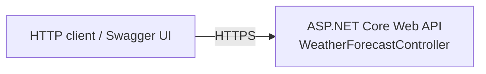

# Full-Stack-Angular-.Net

The ASP.NET Core Web API backend for a planned full-stack Angular + .NET application.

> **Status:** early stage. The repository has the ASP.NET Core Web API project only. There is no Angular front end yet, and the API exposes just the default `WeatherForecast` sample endpoint.

## Features

- ASP.NET Core Web API project using controllers
- Swagger / OpenAPI document and Swagger UI, enabled in the `Development` environment
- One sample endpoint that returns five randomly generated weather forecasts
- HTTPS redirection

## Tech stack

| Component | Version |
| --- | --- |
| Target framework | .NET 7 (`net7.0`) |
| Microsoft.AspNetCore.OpenApi | 7.0.5 |
| Swashbuckle.AspNetCore | 6.4.0 |

## Architecture



No database or front end is wired up yet.

## API endpoints

| Method | Route | Description |
| --- | --- | --- |
| GET | `/WeatherForecast` | Returns 5 forecasts (`date`, `temperatureC`, `temperatureF`, `summary`) with random values |
| GET | `/swagger` | Swagger UI (Development only) |

## Prerequisites

- .NET SDK that can target `net7.0`. The .NET 7 SDK works, and so do newer SDKs (8, 9, 10), which still build `net7.0` but report warning `NETSDK1138` because .NET 7 is out of support.
- To run the app, an ASP.NET Core 7 runtime, or roll-forward to a newer runtime (see below).

## Configuration

`appsettings.json` only holds logging settings and `AllowedHosts`. No connection strings or secrets are needed.

Launch profiles (`Properties/launchSettings.json`):

| Profile | URLs |
| --- | --- |
| `http` / `https` | `https://localhost:7177`, `http://localhost:5204` |

## Getting started

```bash
git clone https://github.com/Ahmed-Manai/Full-Stack-Angular-.Net.git
cd Full-Stack-Angular-.Net
dotnet restore
dotnet build
dotnet run --launch-profile https
```

Then open `https://localhost:7177/swagger`.

If only a newer ASP.NET Core runtime is installed, you can let the app roll forward:

```bash
DOTNET_ROLL_FORWARD=Major dotnet run --launch-profile https
```

### Front end

There is no front end in this repository yet.

## Tests

The repository has no test projects yet.
